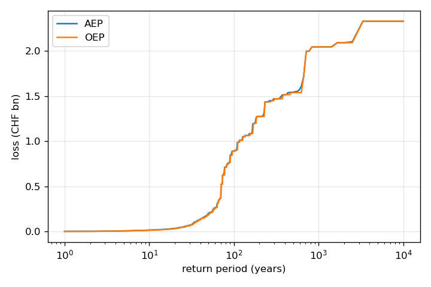
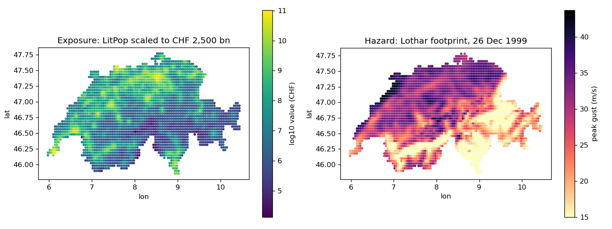
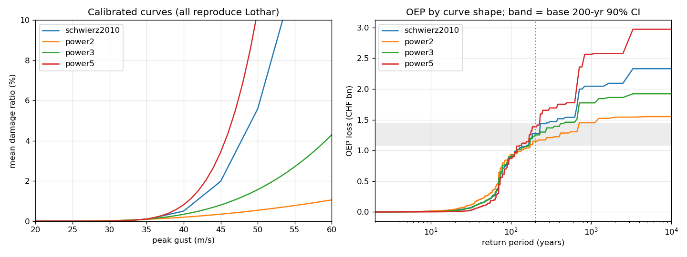
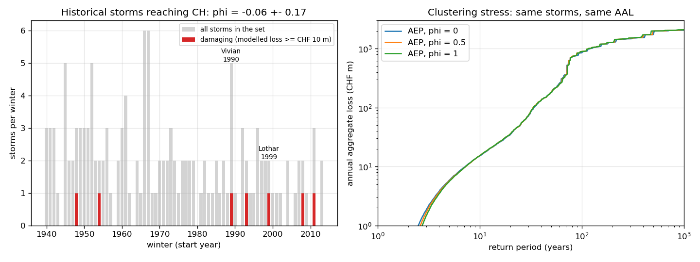

# chstorm: winter storm risk for Swiss buildings

This project studies the question: How much could a European windstorm cost Swiss properties, and what would a reinsurance layer on top of it be worth? This repo was made with open data and [CLIMADA](https://github.com/CLIMADA-project/climada_python). It includes storm footprints, an exposure map, a damage curve calibrated to Lothar (1999), as well as a loss table, EP curves and a cat XL price.

Short summary: [docs/underwriter_summary.md](docs/underwriter_summary.md).

## Takeaways 

1. **The Swiss storm tail is dominated by one storm.** The OEP curve goes from CHF 0.18 bn at 1-in-50 to 0.89 bn at 1-in-100. Everything above that is related to Lothar (1999) and its 29 synthetic variations. In the model, Lothar costs 7 times the next-worst historical storm (Vivian, 1990).
2. **So the calibration anchor matters more than the damage curve.** I tried four curve shapes, each re-calibrated to Lothar. The 1-in-200 loss only moves between CHF 1.15 and 1.39 bn, about the same spread as the Monte Carlo noise. The Lothar loss itself (CHF 500–600 m in 1999, trended to today) moves the tail one for one.
3. **Swapping Schwierz for Welker tests nothing.** In CLIMADA, the Welker curve is a constant ~1.78× Schwierz, so once calibrated both give the same numbers. A useful sensitivity has to change the shape of the curve, not its level.
4. **Storm clustering barely moves this portfolio.** 74 winters of data can't tell clustered from Poisson for Switzerland (φ = −0.06 ± 0.17). Even with strong clustering imposed (φ = 1), the 1-in-200 aggregate loss and the layer price don't change. The tail is a single storm, and a second storm in the same winter is usually small. This would look different for a UK or North Sea book, or for a low layer.

## Results

These come from 10,000 simulated years, with the Schwierz curve scaled ×6.18 so that Lothar costs CHF 0.9 bn on today's portfolio.

| Metric                      | CHF                   |
| --------------------------- | --------------------- |
| Average annual loss         | 23 m (0.009‰ of value) |
| 1-in-50 / 100 / 200 / 250 OEP | 0.18 / 0.89 / 1.27 / 1.44 bn |
| Expected shortfall 99%      | 1.35 bn               |
| Lothar today, modelled return period | ~100 years  |



AEP and OEP lie almost on top of each other: in a bad year the loss comes from one storm, not from several adding up.

Illustrative layer CHF 1,000 m xs 250 m per occurrence, one reinstatement at 100%: expected loss CHF 11.1 m, pure premium 11.0 m, **rate on line 1.10%**, attaches about once in 58 years.



### Damage curve shape

Alternatives of the form damage = ((gust − 25) / 35)^n, n = 2, 3, 5 (n = 3 is the cubic law of Klawa & Ulbrich 2003), each scaled to reproduce Lothar and run on the same simulated years:

| Curve    | 1-in-200 OEP (CHF bn) | Rate on line |
| -------- | --------------------- | ------------ |
| Schwierz | 1.27                  | 1.10%        |
| n = 2    | 1.15                  | 1.14%        |
| n = 3    | 1.25                  | 1.11%        |
| n = 5    | 1.39                  | 1.08%        |

90% bootstrap interval on the base 1-in-200 loss: CHF 1.09 to 1.44 bn.



### Clustering

European winter storms come in runs when the jet stream stays strong and zonal for weeks: Lothar and Martin two days apart in December 1999, or Daria, Vivian and Wiebke in early 1990. Cat models usually assume Poisson arrivals, which ignores this. I tested it in two steps.

- Is it in the Swiss data? I counted the 142 historical storms per winter (1940/41 to 2013/14) and computed the dispersion φ = var/mean − 1 (Mailier et al. 2006). It comes out at −0.06 ± 0.17, which is consistent with Poisson but also with moderate clustering. Only 7 storms caused more than CHF 10 m of modelled loss, too few to test on their own.
- Would it matter? I swapped Poisson for a negative binomial with the same mean (φ = 0.5 and 1) and kept everything else fixed (100,000 years):

| φ   | AAL (CHF m) | 1-in-10 AEP (m) | 1-in-200 AEP (bn) | P(≥2 damaging storms in a year) | Rate on line |
| --- | ----------- | --------------- | ----------------- | ------------------------------- | ------------ |
| 0   | 23.6        | 15.1            | 1.27              | 0.83%                           | 1.10%        |
| 0.5 | 23.8        | 15.3            | 1.28              | 1.00%                           | 1.11%        |
| 1   | 23.8        | 15.3            | 1.28              | 1.16%                           | 1.10%        |

Clustering raises the chance of a multi-storm winter by ~40% but doesn't touch the tail. One caveat: here clustering changes how many storms happen, not how strong they are. Published work (Pinto et al. 2013) finds clustering is stronger for the most intense storms. A Lothar-plus-Martin year, two severe storms in a week, is exactly what this setup can't produce, and with 7 damaging storms in 74 years the Swiss record can't measure it either. If I took this further, that's where I'd look next.



## Assumptions that matter most

Ranked by how far they could move the 1-in-200 loss:

1. **Lothar's loss on today's portfolio.** CHF 600 m building loss in 1999 (Blick reports 600 m, PLANAT 500 m) × an assumed trend factor of 1.5. The tail scales one for one with this. It's the first number I'd want to check against the cantonal insurers' (VKG) loss and insured-value series.
2. **The hazard catalogue.** 142 historical storms with 29 perturbations each. The perturbations stay close to their parent, so the tail rests on very few independent storms. No climate trend.
3. **Exposure.** LitPop's pattern of economic activity rescaled to the CHF 2,500 bn insured by the cantonal building insurers and applied to all of Switzerland. Buildings only: no contents, business interruption, deductibles or limits.
4. **Footprint resolution.** 4.4 km gusts smooth out local peaks (ridges, foehn valleys). The calibration absorbs this on average but not location by location.
5. **Intensity-dependent clustering**, as above.

The layer is illustrative, not a real treaty. Every parameter in [config.yaml](config.yaml) has a source or is labelled as an assumption.

## Running it

```
# conda-forge with OpenBLAS: MKL crashed numpy on my Windows machine
conda create -n climada -c conda-forge --override-channels python=3.11 climada "libblas=*=*openblas" pytest ruff -y
conda activate climada
pip install -e . --no-deps
# Windows: set GDAL_DATA, e.g. $env:GDAL_DATA="$env:CONDA_PREFIX\Library\share\gdal"
pytest
python run.py   # prints every table above and redraws docs/figures/ (a few minutes, data downloads on first run)
```

Code: `src/chstorm/` (`inputs` hazard and exposure, `impact` curves, calibration and year simulation, `clustering`, `metrics` EP and bootstrap, `financial` cat XL with reinstatements; the last two are shared with chquake), `run.py`, `tests/`.

## Not covered

Severe convective storm (hail) is the other major Swiss atmospheric peril. Modelling it properly needs radar hail data and claims that aren't openly available, so I left it out.
